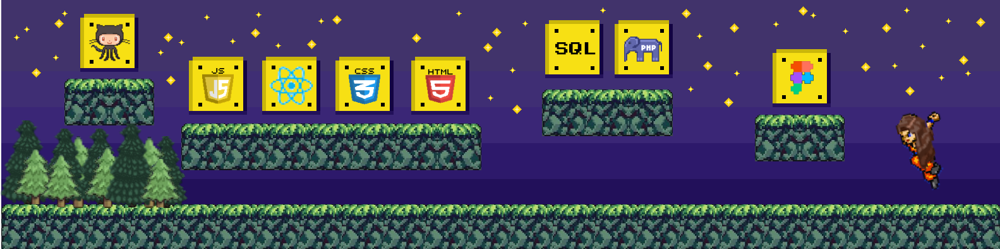
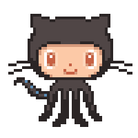

  

<h3>🚀 Building cool stuff with code & curiosity</h3>

  

<h3>👋 Hello!</h3>

🌱 Currently growing my skills in tech & engineering  
🔭 Building [MeOnTrail](https://github.com/KarynaMisnik/meontrail)  
📚 Experimenting with technologies  
⚡ Fun fact: I like assembling IKEA furniture

 

 <h2>🛠️ My Toolbox</h2>

 

 

<h3>Powered by</h3>

     

